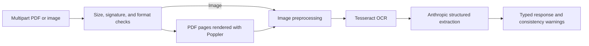

# Medical Bill Extraction API

A FastAPI service that accepts a medical bill as a PDF or image, extracts page text with Tesseract OCR, and asks the Anthropic Messages API to return typed line items. The response includes token usage and non-blocking arithmetic and duplicate-item warnings.

This repository is an inference/API project. It does not train a machine-learning model and does not provide a validated fraud detector.

## Scope and limitations

- The API accepts a multipart file upload; it does not fetch document URLs.
- Images are limited to 40 megapixels in addition to the configured upload-size limit.
- The current extraction stage uses an Anthropic model to interpret OCR text. Results can be incomplete or incorrect and must be reviewed by a person before being used for billing or payment decisions.
- Arithmetic warnings check whether `item_rate × item_quantity` approximately equals `item_amount`. Legitimate discounts, taxes, or rounding may cause differences.
- Duplicate warnings are hints only: repeated charges can be legitimate.
- The visual heuristics retained in `DocumentPreprocessor.experimental_visual_flags` are unvalidated and are not used by the API. They must not be treated as evidence of fraud.
- No labeled evaluation set, reproducible benchmark, or verified accuracy/latency measurement is included. No performance figures are claimed.
- The sample PDFs have not been verified as de-identified. Review them before sharing or sending them to any external service.
- A local `.env` file was present in the repository history. Removing it from the current checkout does not remove values from earlier commits or clones. Revoke and replace any credential that may have been committed; coordinate history cleanup with repository collaborators before rewriting shared history.

## How it works



Each page is preprocessed and OCRed locally. The recognized text is sent to Anthropic for structured extraction. The service validates the returned shape, calculates token usage, and returns warnings for arithmetic mismatches and exact repeated item names/amounts across pages. It does not retain uploaded files intentionally, but hosting infrastructure, logs, or the external provider may have separate retention behavior.

## Project layout

```text
app/
  __init__.py       Package version metadata
  config.py         Environment-backed settings
  document_io.py    Input validation and PDF page conversion
  extraction.py     Anthropic integration and response parsing
  main.py           FastAPI endpoints and processing workflow
  ocr_engine.py     Tesseract adapter
  preprocessing.py  Image enhancement and experimental visual heuristics
  schemas.py        Canonical request/response data models
  validation.py     Arithmetic and duplicate-item warnings
sample_data/        Example PDFs (review for sensitive information)
tests/              Offline unit and pipeline tests
.env.example        Environment variable template (no credentials)
.gitignore          Local secrets, environments, and generated files
.dockerignore       Excludes local secrets and non-runtime files from images
Dockerfile          Container build and runtime
requirements.txt    Pinned Python runtime dependencies
.github/workflows/  CI test workflow
```

## Requirements

- Python 3.11 (the container is based on `python:3.11-slim`)
- Tesseract OCR available on `PATH`
- Poppler utilities (`pdfinfo` and `pdftoppm`) available on `PATH` for PDF input
- An Anthropic API key and network access to the Anthropic API for bill extraction

The Docker image installs Tesseract and Poppler. For local Windows development, install Tesseract and Poppler separately and add their executable directories to `PATH`. Image-only requests do not need Poppler.

## Installation

### Windows PowerShell

```powershell
py -3.11 -m venv .venv
.\.venv\Scripts\Activate.ps1
python -m pip install --upgrade pip
python -m pip install -r requirements.txt
Copy-Item .env.example .env
```

Edit `.env` and set `ANTHROPIC_API_KEY`. The application loads this local file through `python-dotenv`; `.env` is ignored by Git and excluded from Docker builds. Alternatively, set the variable in the process environment. Never reuse a key that may have appeared in a previous repository commit; revoke it and create a replacement.

### Linux/macOS

Install Tesseract and Poppler using the operating system package manager, then:

```bash
python3.11 -m venv .venv
source .venv/bin/activate
python -m pip install --upgrade pip
python -m pip install -r requirements.txt
cp .env.example .env
```

Set `ANTHROPIC_API_KEY` in `.env` before making extraction requests.

## Configuration

| Variable | Default | Description |
|---|---:|---|
| `ANTHROPIC_API_KEY` | unset | Required for extraction; requests return HTTP 503 if absent |
| `ANTHROPIC_MODEL` | `claude-sonnet-4-20250514` | Anthropic model identifier |
| `ANTHROPIC_MAX_TOKENS` | `4096` | Maximum output tokens for each page |
| `MAX_FILE_SIZE_MB` | `50` | Maximum uploaded document size |
| `MAX_DOCUMENT_PAGES` | `50` | Maximum pages in a PDF |
| `PDF_RENDER_DPI` | `300` | Resolution used to render PDF pages |

Integer settings must be positive. The Anthropic API is a third-party service: OCR text from uploaded bills is sent to that provider. Confirm your organization’s privacy, consent, and regulatory requirements before using real medical or financial records.

## Run the API

From the repository root:

```powershell
python -m uvicorn app.main:app --host 127.0.0.1 --port 8000
```

Open the interactive API documentation at `http://127.0.0.1:8000/docs`. `GET /health` is a liveness check; it does not verify Tesseract, Poppler, API-key validity, or Anthropic availability.

### Extract from a bill

The endpoint expects a multipart form field named `file`:

```powershell
curl.exe -F "file=@sample_data/Sample Document 1.pdf" http://127.0.0.1:8000/extract-bill-data
```

For an image:

```powershell
curl.exe -F "file=@path\to\bill.png" http://127.0.0.1:8000/extract-bill-data
```

Successful responses contain page types, item names, amounts, rates, quantities, per-page validation warnings, duplicate-item warnings, and actual Anthropic token usage. The API returns standard HTTP errors for empty, unsupported, oversized, invalid, or unprocessable documents and for unavailable OCR/LLM services.

Example response shape:

```json
{
  "is_success": true,
  "token_usage": {
    "total_tokens": 1200,
    "input_tokens": 1100,
    "output_tokens": 100
  },
  "data": {
    "pagewise_line_items": [
      {
        "page_no": 1,
        "page_type": "Bill Detail",
        "bill_items": [
          {
            "item_name": "Example item",
            "item_amount": 200.0,
            "item_rate": 100.0,
            "item_quantity": 2.0
          }
        ],
        "validation_warnings": []
      }
    ],
    "total_item_count": 1,
    "warnings": []
  }
}
```

Values above illustrate the response format only; they are not results from the included PDFs or a benchmark.

## Run with Docker

```bash
docker build -t medical-bill-extraction .
docker run --rm -p 8000:8000 --env-file .env medical-bill-extraction
```

Then send a multipart upload to `http://localhost:8000/extract-bill-data` as shown above. The Docker build excludes local environment files, sample documents, and tests.

## Tests

The tests use Python's built-in `unittest` and mock external OCR/LLM calls. They do not require API credentials, Tesseract execution, Poppler, or network access.

```powershell
python -m unittest discover -s tests -v
```

This suite checks document validation, preprocessing, schema/extraction behavior, arithmetic warnings, and integration of the processing pipeline with mocked external services. It does not measure OCR quality or model accuracy.

## Future work

- Assemble an authorized, de-identified, labeled evaluation set and report extraction precision/recall and field-level error rates.
- Evaluate OCR and extraction across representative scans, layouts, and currencies.
- Add authentication, rate limiting, operational monitoring, and an explicit retention policy before public deployment.
- Develop and independently validate any fraud-analysis method before presenting it as a product capability.

## References

- [FastAPI documentation](https://fastapi.tiangolo.com/)
- [Anthropic Messages API](https://docs.anthropic.com/en/api/messages)
- [pytesseract](https://github.com/madmaze/pytesseract)
- [pdf2image](https://pdf2image.readthedocs.io/en/latest/)

## Repository description and topics

Suggested GitHub description: **“FastAPI service for OCR and structured line-item extraction from medical bill PDFs and images.”**

Suggested topics: `fastapi`, `ocr`, `document-processing`, `anthropic`, `medical-billing`, `python`.
